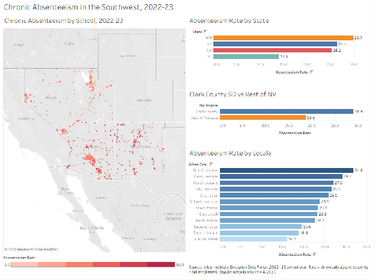

# Chronic Absenteeism in the Southwest (2022–23)

How does chronic absenteeism in Nevada compare to Arizona, Utah, and New Mexico, and where within Nevada is it concentrated?

[**View the interactive Tableau dashboard**](https://public.tableau.com/app/profile/preston.gunter/viz/SouthwestSchoolsChronicAbsenteeism2022-23/AbsenteeismDashboard)



---

## Headline finding

**Clark County School District's chronic absenteeism rate (28.9%) is about 10 points higher than the rest of Nevada's (18.6%).** Because Clark enrolls roughly 64% of Nevada's students, it drives the statewide rate. Clark's ~89,000 chronically absent students is close to the total for all of New Mexico (~90,000).

## Why this question

I'm a special education co-teacher in the Clark County School District. I am very interested in educational data and how we can use that data to help the students I work with. I wanted to find datasets that answered questions I have on a macro level about education so I started with chronically absent students and how Nevada compares to other surrounding states.  

## The question

> How did chronic absenteeism rates in Nevada compare to Arizona, Utah, and New Mexico in the most recent available school year?

Follow-up questions:

- Does absenteeism differ by school level (elementary, middle, high)?  
- Does it differ by how urban or rural a school is?  
- Within Nevada, how does Clark County compare to the rest of the state?

## Data

|  |  |
| :---- | :---- |
| **Source** | [Urban Institute Education Data Portal](https://educationdata.urban.org/data-explorer), school-level data. School characteristics, enrollment, locale, and location come from the NCES **Common Core of Data (CCD)**. Chronically absent students come from the U.S. Department of Education's **Civil Rights Data Collection (CRDC)**. |
| **Year** | 2022 (the 2022–23 school year) |
| **States** | Arizona, Nevada, New Mexico, Utah |
| **Unit** | One row per school |
| **Key fields** | Enrollment, chronically absent students, school level and type, charter, virtual, urban-centric locale, district, latitude/longitude |

**Definitions**

- **Chronically absent:** a student who missed 15 or more school days during the year, for any reason (excused, unexcused, or suspension).  
- **Enrollment:** a single-day count taken in the fall.  
- **Absenteeism rate:** `SUM(chronically absent) × 100 / SUM(enrollment)`. Students are summed before dividing, so a 2,000-student school counts more than a 20-student school. Averaging each school's rate would give small schools too much weight.

### Locale categories

Locale comes from NCES's urban-centric locale codes, which are based on Census Bureau urban area definitions. Each category is set by where the school is located and by that area's population or the school's distance from it.

| Locale | Definition |
| :---- | :---- |
| City, large / midsize / small | Inside a principal city of an urbanized area; city population 250,000+ / 100,000–249,999 / under 100,000 |
| Suburb, large / midsize / small | Inside an urbanized area but outside the principal city; urbanized area population 250,000+ / 100,000–249,999 / under 100,000 |
| Town, fringe / distant / remote | Inside a smaller urban area (urban cluster); within 10 miles / 10–35 miles / more than 35 miles from an urbanized area |
| Rural, fringe | Outside urban areas; within 5 miles of an urbanized area or within 2.5 miles of an urban cluster |
| Rural, distant | 5–25 miles from an urbanized area, or 2.5–10 miles from an urban cluster |
| Rural, remote | More than 25 miles from an urbanized area and more than 10 miles from an urban cluster |

Source: [NCES Locale Definitions](https://nces.ed.gov/programs/edge/docs/locale_definitions.pdf)

## Tools and pipeline

```
Urban Institute CSV ──► PostgreSQL (Neon) ──► SQL cleaning + analysis ──► CSV export ──► Tableau Public
                         schools_raw           schools_clean              schools_analysis.csv
                                               schools_analysis (view)
```

- **PostgreSQL on Neon**, managed with **pgAdmin**  
- **SQL** for cleaning, validation, and analysis (`analysis.sql`)  
- **Tableau Public** for the dashboard

Database tables:

1. `schools_raw`: the original CSV, imported with every column as TEXT so nothing was lost or misread on import.  
2. `schools_clean`: typed and renamed columns, with inactive, closed, and future schools removed (5,169 schools). The primary key is `ncessch`, the NCES school ID.  
3. `schools_analysis` (view): the final analysis set of 4,193 schools.

The database connection string is stored in an environment variable (`DATABASE_URL`) and is not committed to this repo.

## Cleaning decisions

Going from 5,169 operating schools to 4,193 analysis schools:

| Removed | Schools | Why |
| :---- | :---- | :---- |
| Vocational schools | 289 | Not regular schools; students often attend part-time |
| Alternative schools | 278 | Students move in and out all year (see below) |
| Special education schools | 119 | Same enrollment problem as alternative schools |
| Regular schools with blank data | 274 | No enrollment or absenteeism reported; many are virtual |
| Enrollment of 0 | 4 | Can't calculate a rate |
| More absent than enrolled | 12 | Impossible values |
| **Total removed** | **976** | **5,169 → 4,193** |

**Why drop alternative and special education schools?** Enrollment is a one-day fall snapshot, but chronic absenteeism counts every student who attended at any point during the year. At schools where students constantly come and go, the absent count can exceed the fall enrollment. Before filtering, **109 schools reported more chronically absent students than enrolled students**. For example, Variety ES, a CCSD special education school, reports 19 students, which is far fewer than actually attend during the year.

**Sensitivity check:** Restricting the data to regular schools changed each state's rate by less than 0.5 percentage points, so this decision doesn't drive the results.

## Key findings

### 1. By state

| State | Rate | Chronically absent students | Schools |
| :---- | :---- | :---- | :---- |
| New Mexico | **29.7%** | 90,395 | 801 |
| Arizona | 26.3% | 279,468 | 1,747 |
| Nevada | 25.2% | 120,936 | 682 |
| Utah | **14.0%** | 93,077 | 963 |

Nevada ranks in the middle of the four. Utah is the clear outlier, at about half the rate of the other three states.

**Rates vs. counts:** New Mexico has the highest *rate*, but Arizona has three times as many chronically absent students. The rate shows where the problem is most severe, and the count shows where an intervention would reach the most students.

### 2. By school level

High schools (25.0%) > middle schools (24.0%) > elementary schools (22.8%).

**Utah reverses this pattern:** its high schools (12.0%) have *lower* absenteeism than its elementary schools (16.2%).

### 3. By locale

The rate ranges from **31.8% in "Rural, remote"** schools down to **16.1% in "Suburb, small"** schools. Remote rural areas and remote towns (29.2%) have the highest rates.

### 4. Within Nevada

| District | Rate |
| :---- | :---- |
| Clark County School District | **28.9%** |
| Washoe County School District | 19.2% |
| State-sponsored charter schools | 14.3% |
| **Rest of Nevada (everything except Clark)** | **18.6%** |

## Limitations

- **Fall snapshot.** Enrollment is counted on one day in the fall, while absenteeism covers the whole year. Schools with high student turnover can look worse (or impossible) on this measure. This is why alternative and special education schools were excluded.  
- **Correlation, not causation.** These results show *where* absenteeism is high, not *why*. Clark County differs from the rest of Nevada in poverty, size, and student population, and this analysis doesn't separate those factors.  
- **Locale is based on school address.** It describes where the school is, not where students live, and it isn't a measure of income.  
- **One school year.** 2022–23 was still close to the COVID-19 disruptions, so these rates may be higher than in a typical year. One year can't show trends.  
- **Title I status was blank** for every 2022 row, so poverty couldn't be included in this version.  
- **Excluded schools.** The findings apply to regular schools only.

## Next steps (v2)

- **Automate the data pull with Python** using the Urban Institute Education Data API, instead of downloading from the Data Explorer by hand.  
- **Join Title I status from another year** on `ncessch` to test whether poverty explains the Clark County gap.  
- **Add a national benchmark** for context.  
- Explore **absenteeism vs. state test scores**.

## Repo contents

| File | Description |
| :---- | :---- |
| `analysis.sql` | All SQL in order: building `schools_clean`, data checks, the `schools_analysis` view, and each analysis query with its results |
| `data/EducationDataPortal_10.05.2026_Schools.csv` | The raw download from the Urban Institute Data Explorer (imported into `schools_raw`) |
| `data/EducationDataPortal_10.05.2026_datadictionary.csv` | Data dictionary from the download: each variable's label, source, and year |
| `data/schools_analysis.csv` | The final 4,193-school dataset used in Tableau |
| `dashboard.png` | Screenshot of the Tableau dashboard |
| `README.md` | This file |

## About me

Preston Gunter, special education co-teacher in the Clark County School District transitioning into data analytics. Computer Information Technology degree, BYU-Idaho.
